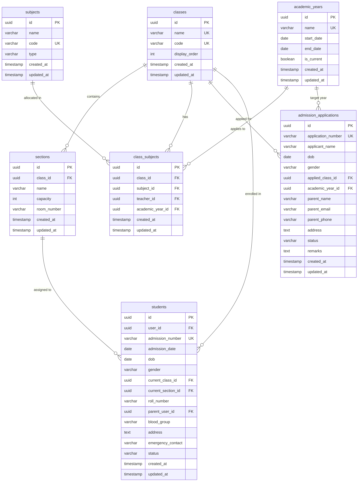

# Core ERP Modules — Database Schema
> **Phase 2: System Design** | Modules 4, 5, 6 of 20
> Tables: `academic_years`, `classes`, `sections`, `subjects`, `class_subjects`, `admission_applications`, `students`

---

## Entity Relationship Diagram



---

## Table Definitions

### `academic_years`
Stores the target fiscal/academic duration sessions.
```sql
CREATE TABLE academic_years (
    id         UUID PRIMARY KEY DEFAULT gen_random_uuid(),
    name       VARCHAR(50) NOT NULL UNIQUE,
    start_date DATE NOT NULL,
    end_date   DATE NOT NULL,
    is_current BOOLEAN NOT NULL DEFAULT FALSE,
    created_at TIMESTAMP WITH TIME ZONE NOT NULL DEFAULT NOW(),
    updated_at TIMESTAMP WITH TIME ZONE NOT NULL DEFAULT NOW()
);
```

### `classes`
Target class structures.
```sql
CREATE TABLE classes (
    id            UUID PRIMARY KEY DEFAULT gen_random_uuid(),
    name          VARCHAR(50) NOT NULL UNIQUE,
    code          VARCHAR(20) UNIQUE,
    display_order INT NOT NULL DEFAULT 0,
    created_at    TIMESTAMP WITH TIME ZONE NOT NULL DEFAULT NOW(),
    updated_at    TIMESTAMP WITH TIME ZONE NOT NULL DEFAULT NOW()
);
```

### `sections`
Nested classroom subdivisions under specific classes.
```sql
CREATE TABLE sections (
    id          UUID PRIMARY KEY DEFAULT gen_random_uuid(),
    class_id    UUID NOT NULL REFERENCES classes(id) ON DELETE CASCADE,
    name        VARCHAR(50) NOT NULL,
    capacity    INT DEFAULT 40,
    room_number VARCHAR(20),
    created_at  TIMESTAMP WITH TIME ZONE NOT NULL DEFAULT NOW(),
    updated_at  TIMESTAMP WITH TIME ZONE NOT NULL DEFAULT NOW(),
    UNIQUE(class_id, name)
);
```

### `subjects`
Target course subjects.
```sql
CREATE TABLE subjects (
    id         UUID PRIMARY KEY DEFAULT gen_random_uuid(),
    name       VARCHAR(100) NOT NULL,
    code       VARCHAR(20) NOT NULL UNIQUE,
    type       VARCHAR(20) NOT NULL DEFAULT 'core', -- 'core', 'elective', 'lab', 'activity'
    created_at TIMESTAMP WITH TIME ZONE NOT NULL DEFAULT NOW(),
    updated_at TIMESTAMP WITH TIME ZONE NOT NULL DEFAULT NOW()
);
```

### `class_subjects`
Allocations mapping teachers to teach core subjects in respective classes during particular Academic Years.
```sql
CREATE TABLE class_subjects (
    id               UUID PRIMARY KEY DEFAULT gen_random_uuid(),
    class_id         UUID NOT NULL REFERENCES classes(id) ON DELETE CASCADE,
    subject_id       UUID NOT NULL REFERENCES subjects(id) ON DELETE CASCADE,
    teacher_id       UUID REFERENCES users(id) ON DELETE SET NULL,
    academic_year_id UUID NOT NULL REFERENCES academic_years(id) ON DELETE CASCADE,
    created_at       TIMESTAMP WITH TIME ZONE NOT NULL DEFAULT NOW(),
    updated_at       TIMESTAMP WITH TIME ZONE NOT NULL DEFAULT NOW(),
    UNIQUE(class_id, subject_id, academic_year_id)
);
```

### `admission_applications`
Prospect profiles undergoing approval steps.
```sql
CREATE TABLE admission_applications (
    id                 UUID PRIMARY KEY DEFAULT gen_random_uuid(),
    application_number VARCHAR(50) NOT NULL UNIQUE,
    applicant_name     VARCHAR(100) NOT NULL,
    dob                DATE NOT NULL,
    gender             VARCHAR(10) NOT NULL,
    applied_class_id   UUID NOT NULL REFERENCES classes(id) ON DELETE CASCADE,
    academic_year_id   UUID NOT NULL REFERENCES academic_years(id) ON DELETE CASCADE,
    parent_name        VARCHAR(100) NOT NULL,
    parent_email       VARCHAR(255) NOT NULL,
    parent_phone       VARCHAR(20) NOT NULL,
    address            TEXT,
    status             VARCHAR(20) NOT NULL DEFAULT 'submitted', -- 'submitted', 'under_review', 'approved', 'rejected', 'enrolled'
    remarks            TEXT,
    created_at         TIMESTAMP WITH TIME ZONE NOT NULL DEFAULT NOW(),
    updated_at         TIMESTAMP WITH TIME ZONE NOT NULL DEFAULT NOW()
);
```

### `students`
Student records mapped from approved admissions.
```sql
CREATE TABLE students (
    id                 UUID PRIMARY KEY DEFAULT gen_random_uuid(),
    user_id            UUID NOT NULL UNIQUE REFERENCES users(id) ON DELETE CASCADE,
    admission_number   VARCHAR(50) NOT NULL UNIQUE,
    admission_date     DATE NOT NULL DEFAULT CURRENT_DATE,
    dob                DATE NOT NULL,
    gender             VARCHAR(10) NOT NULL,
    current_class_id   UUID REFERENCES classes(id) ON DELETE SET NULL,
    current_section_id UUID REFERENCES sections(id) ON DELETE SET NULL,
    roll_number        VARCHAR(20),
    parent_user_id     UUID REFERENCES users(id) ON DELETE SET NULL,
    blood_group        VARCHAR(5),
    address            TEXT,
    emergency_contact  VARCHAR(20),
    status             VARCHAR(20) NOT NULL DEFAULT 'active', -- 'active', 'transferred', 'graduated', 'suspended'
    created_at         TIMESTAMP WITH TIME ZONE NOT NULL DEFAULT NOW(),
    updated_at         TIMESTAMP WITH TIME ZONE NOT NULL DEFAULT NOW()
);
```
